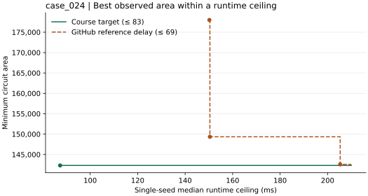

# 乙的构造种子实验

在 GitHub 主分支 `585b22a` 的原 C++ 求解器中接入 11 种初始构造，包含 GitHub 的现有构造、历史版的条件逆序构造，以及 9 种单独控制顺序、分组、逻辑展开和映射的构造。所有种子都复用原有门库、网表和预算。新实验通过环境变量开启。运行默认求解器仍使用课程的两个路径参数。

## 单独比较每个构造

每次启动一个求解器，仅选择一种构造，生成一个完整电路。随后统一做网表规范化、一次完整的原版代数改写，再按同一规则从输入与改写后的两个候选里选出实际输出。GitHub 对照同样只做这一次改写。另测原发布版的默认流程，以它作为实际部署对照。

在 Apple 芯片 Mac 上的 Linux x86-64 容器内使用 GCC 13.5.0 和课程官方 evaluator。25 例，1 轮预热、5 轮独立计时，乱序交替运行构造。每轮时间来自官方 CSV，包含读入、构造、后续优化、选网表、写出及退出。11 × 25 × 5 = 1,375 次正式测量全部 PASS，每个用例同一配置五轮的网表哈希一致。程序代码对应实验提交 `fdf34db`。

逐例比较面积和延迟时，相同坐标只计一次。相对原 GitHub 构造，19 个用例共增加 33 个互不支配的面积／延迟点，17 例有面积更小且仍满足目标延迟的方案。按范围比较程序耗时时，先要求五次结果均有效，再比较耗时中位数。只靠时间获得保留资格的方案，还须在同例中比所有面积和延迟均不差的替代方案都快，实测区间分离超过 0.2 毫秒和自身中位数 5% 中的较大者。这是筛选标准，不代表课程评分公式。

| 入选理由 | 构造及各自新增的面积／延迟点数 |
|---|---|
| 原对照 | GitHub |
| 新增面积／延迟点 | 递归三变量分组 12、历史条件逆序 9、按输出变化排序 9、正序顶层三变量分组 1、逆序顶层三变量分组 1、自适应分组 1 |
| 仅在加入总耗时后入选 | 正序和之积展开、正序积之和再做双极性映射 |
| 未达保留标准，仍可单独复验 | 简单正序积之和、简单逆序积之和 |

以 case_024 为例，以下耗时为单独启用这一种构造的五轮中位数。

| 构造 | 面积 | 延迟 | 整个求解程序耗时（ms） |
|---|---:|---:|---:|
| GitHub 对照 | 178001 | 69 | 150.197 |
| 递归三变量分组 | 149346 | 63 | 150.427 |
| 历史条件逆序 | 142588 | 69 | 205.306 |

横轴是挑选单个构造时允许的五轮耗时中位数。按本例的课程延迟上限 83，逆序顶层三变量分组在 87.326 ms 达到面积 142318、延迟 79，此后放宽耗时上限也没有更小的达标电路。若要求延迟不超过 GitHub 对照的 69，最小面积在 150.197、150.427、205.306 ms 依次降至 178001、149346、142588。曲线来自 11 个构造的独立实测；组合运行的实际耗时见下一节。安装 Matplotlib 后，在仓库根目录运行 `python3 research/seed_study/plot_quality_cost.py` 可从逐例数据重新绘图。

[各构造及版本来源](../research/seed_study/provenance.md) · [逐例数据](../results/seed-study-linux-20261117/comparison.csv) · [保留清单](../results/seed-study-linux-20261117/retained.json)

## 一次启动，同时尝试保留下来的构造

组合在一个总预算下运行，先保存 GitHub 电路，再依次处理入选构造。每个完成的候选按实际面积和最长路径延迟进入前沿，最终采用原项目的延迟达标优先与折中选择规则。它和默认发布配置交替实测五轮，分别各 125 次，全部 PASS、全部达到目标延迟。此处的总运行时间直接测量同一进程。程序代码对应提交 `e11f117`。

| 指标 | 原默认配置 | 9 种构造组合 |
|---|---:|---:|
| 25 例逐例耗时中位数之和 | 1573.561 ms | 4027.414 ms |
| case_024 面积／延迟 | 178001／69 | 149346／63 |
| case_024 进程耗时中位数 | 208.955 ms | 718.611 ms |

逐例看，组合在 8 例的面积和延迟均不差且至少一项改善，7 例两项相同，10 例两项有取舍。组合在这批输入上消耗原默认配置约 2.56 倍的总时间。默认配置仍为原发布版，组合是可选策略。每例保留的全部替代点与最后选出的单个网表用途不同。公开用例的保留名单反映本组数据，时间取决于测量机器。

[组合与发布版逐例结果](../results/seed-portfolio-linux-20261117/comparison.csv) · [如何编译并复现](../research/seed_study/README.md)

独立验证包括 400 个生成用例及 154 次针对种子接口的完整逻辑验证。原仓库的局部改写单元测试在目标 Linux 上通过；该测试包含一个 1 KB 内存断言，依赖 Linux 的 /proc 统计，在 macOS 原生环境未通过。两轮官方 Linux 矩阵与组合均使用原始课程数据和官方评测程序，每轮原始 CSV 和源代码哈希分别保存在结果目录。
